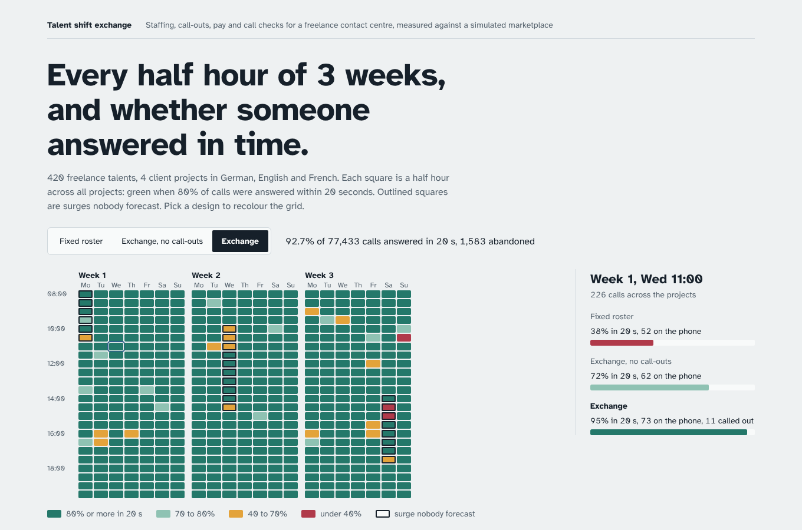

# talent-shift-exchange

A shift exchange for a freelance contact-centre marketplace. Client projects need people on the phone in every half
hour; freelance talents pick the shifts they want from home; the platform has to make both work. It does five things:

- **plans** each half hour from a forecast of calls and Erlang C, per project, language and weekday;
- **books** the shifts talents ask for by how reliably they show up and how much of their ask they have had, and books
  a little over the need where no-shows are expected;
- **calls out** free, certified talents when a half hour runs hotter than planned or people do not log in;
- **pays** talents per productive minute from the events their apps send, which arrive twice, late and out of order;
- **checks calls** against each client's guidelines: rules for fixed phrases, a model for promises an agent may not
  make, and a person for every call the model is not sure about.

A FastAPI service with SQLAlchemy carries the claims and the ledger. A seat is a database row, so two talents tapping
the last seat at once cannot both get it. Everything is measured against a simulated marketplace
(420 talents, 4 client projects in German, English and French, 3 weeks) and a held-out
marketplace that was run once.



## Staffing

Dev world, 77,433 calls. Every design meets the same calls, the same talents asking for the same
shifts, and the same no-shows, because every draw is keyed by what it is about. The held-out world H1 was run once.

| design | answered in 20 s | half hours on 80/20 | abandoned calls | answered in surges | talent € per logged hour | talents under half their ask | held-out H1 |
|---|---|---|---|---|---|---|---|
| Fixed roster | 66.8% | 62.8% | 7,509 | 2.6% | €7.08 | 22.4% | 52.2%, 11,457 lost, surge 5.9% |
| Exchange, no call-outs | 81.8% | 79.4% | 3,997 | 23.6% | €6.74 | 3.1% | 62.6%, 9,655 lost, surge 22.9% |
| **Exchange** | 92.7% | 93.2% | 1,583 | 60.5% | €6.13 | 3.1% | 81.9%, 4,761 lost, surge 36.6% |

- **Fixed roster:** one headcount per project and shift, planned on the average day and used every day, first come
  first served. Many contact centres still plan this way. Mondays and peaks are short, and quiet weekends are overstaffed.
- **Exchange, no call-outs:** the weekday- and half-hour-aware plan, reliability-aware overbooking and fairness, but
  nothing changes once the week starts.
- **Exchange:** the plan plus intraday call-outs. Over 3 weeks it sent 3,086 offers and
  1,082 were taken.

Talents are paid per productive minute, so staffing up costs them occupancy: the exchange answers
26.0 points more of the calls in 20 s than the fixed roster, and talents earn
€6.13 per logged hour instead of €7.08. In total
they earn €8,635 more because there is more work. The gate holds a floor
of €6 per logged hour so the service level is not bought with the talents' pay.

## Pay

3,537 sessions, 350,005 events, 13,436 of them repeats. Truth: productive seconds
in the world, after-call work capped by the client contract, €0.24 per minute, integer cents.

| ledger | overpaid | underpaid | talents paid wrong | held-out H1 |
|---|---|---|---|---|
| Events in the order they arrive | €45 | €6,654 | 419 of 420 | 12.3% of pay wrong, 379 talents |
| **Ledger by sequence number** | €0 | €0 | 0 of 420 | 0.0% of pay wrong, 0 talents |

Events are stored once by their id and folded per session by the app's own sequence number, never by arrival order
or device clock. A week's statement is never changed once issued: work that arrives late adds an adjustment row with
the difference, and asking again with nothing new adds nothing.

## Call quality

3,000 calls, 10,500 guideline checks, 290 broken promises. The model is a
stand-in in the world: it misses some breaches, flags some clean calls, and its confidence is only partly honest.

| design | broken promises found | all breaches found | clean checks flagged | people's time | held-out H1 |
|---|---|---|---|---|---|
| People listen to 5% of calls | 3.8% | 5.2% | 0 | 10.3 h | 4.0%, 0 false, 9.9 h |
| The model decides alone | 88.6% | 97.5% | 83 | 0.0 h | 82.8%, 110 false, 0.0 h |
| **Product** | 100.0% | 100.0% | 3 | 36.0 h | 99.2%, 14 false, 51.1 h |

Reading every call would take 200.0 hours. Greeting, identity check and summary are fixed
phrases, so rules check them. A promise needs judgement, so the model reads the agent's lines (never the customer's).
Code sends a call to a person when the model is under 0.85 confident, or when it says "fine" but the agent used a
word like promise or guarantee.

## Claims under load

250 claims from 200 talents (every fourth taps twice) for one shift with
40 seats, 32 at a time: 40 seats taken by 40 talents,
0 double bookings, and everyone else told the shift is full. A repeat claim returns the seat the
talent already has. Which talents win changes from run to run; that it is exactly one per seat does not.

## Gate

The gate was written after the first dev results and before the held-out world was run (`config/gate.yaml`). Dev
numbers are after the fixes that came out of the held-out run. H1 numbers are from its one run, before them.

| line | dev | held-out H1 |
|---|---|---|
| calls answered within 20 s | 0.927 ✅ | 0.8186 ✅ |
| half hours on the 80/20 target | 0.9315 ✅ | 0.8249 ✅ |
| answered in surges nobody forecast | 0.605 ✅ | 0.366 ❌ |
| fewer abandoned calls than the fixed roster | 1,583 ✅ | 4,761 ✅ |
| call-outs lose fewer calls than planning alone | 1,583 ✅ | 4,761 ✅ |
| talents earn at least 6 euro per logged hour | 6.13 ✅ | 7.01 ✅ |
| talents earn more in total than on the fixed roster | 99,123 ✅ | 113,227 ✅ |
| at most 1 in 10 talents gets under half the hours asked for | 0.031 ✅ | 0 ✅ |
| no talent paid a cent wrong | 0 ✅ | 0 ✅ |
| two claims never get one seat | 0 ✅ | 0 ✅ |
| broken promises found | 1 ✅ | 0.9919 ✅ |
| clean calls flagged | 0.0003 ✅ | 0.0016 ✅ |
| people read at most a quarter of what reading every call costs | 0.18 ✅ | 0.2555 ❌ |

Dev passes 13 of 13 lines. H1 passed 11 of 13:
- the surges were bigger and the pool thinner, and call-outs stopped at the shift change;
- a less honest model sent more calls to people than the gate allows.

[docs/heldout.md](docs/heldout.md) has the detail: what was fixed and measured on dev, and what is open.

## Run it

```bash
pip install -r requirements.txt
python -m pytest -q                                # staffing, ledger, call checks, API race, invariants: seconds
python -m tse.eval.cli evaluate                    # three staffing designs, ledger, call checks and the gate
TSE_SERVE=1 uvicorn tse.product.api:app            # the API, on SQLite in memory unless TSE_DB is set
cd web && npm ci && npm run dev                    # the dashboard
```

Where things live:
- `tse/world`: the marketplace and its truth, including the stand-in model;
- `tse/product`: what would ship, which never imports the world;
- `tse/eval`: designs, scoring, gate and this README;
- `web`: the dashboard, which reads the same reports.

[docs/agentic-workflow.md](docs/agentic-workflow.md) describes how this was built with a coding agent: where it
helped, where it went wrong, and the checks that caught it.
